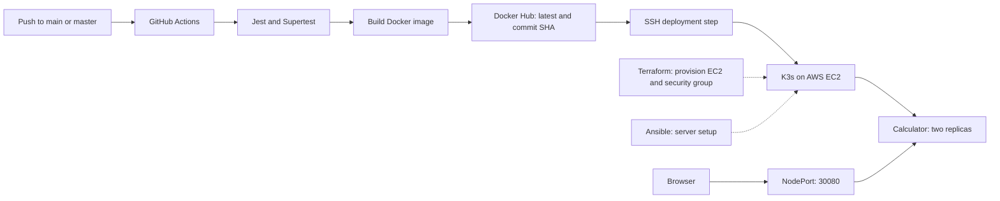

# End-to-End CI/CD Pipeline for a Calculator App

A simple web calculator used to demonstrate continuous integration and continuous deployment with **GitHub Actions, Docker Hub, Kubernetes (K3s), AWS EC2, Terraform, and Ansible**.

## Project overview

The application provides a French-language web interface for addition, subtraction, multiplication, and division. An Express API performs calculations and returns errors for invalid numbers, unsupported operations, and division by zero.

The project demonstrates the delivery process around this small application: automated tests, container publishing, infrastructure provisioning, and deployment updates on AWS.

## Architecture



Infrastructure provisioning and initial cluster setup are separate from the GitHub Actions workflow. The workflow updates an existing Kubernetes Deployment.

## Technology stack

| Area | Tools |
| --- | --- |
| Application | Node.js, Express, HTML, CSS, JavaScript |
| Testing | Jest, Supertest |
| Automation | GitHub Actions |
| Containers and registry | Docker, Docker Hub |
| Infrastructure | Terraform, AWS EC2, AWS security group |
| Server configuration | Ansible |
| Deployment | Kubernetes via K3s, two replicas, NodePort Service |

## Repository structure

```text
.
├── .github/workflows/    # Automated test, build, push, and deployment workflow
├── ansible/             # Inventory, configuration, and K3s master playbook
├── k8s/                 # Kubernetes Deployment and Service
├── public/              # Calculator web interface
├── terraform/           # AWS infrastructure definitions
├── test/app.test.js     # Calculation and API tests
├── app.js               # Express app and calculation logic
├── server.js            # HTTP server on port 3000
├── Dockerfile           # Node.js 20 Alpine container
├── package.json
└── package-lock.json
```

## Run locally

Install Node.js and npm, then run from the repository root:

```bash
npm ci
npm start
```

Open **http://localhost:3000**.

The Docker image uses Node.js 20; the current GitHub Actions workflow uses Node.js 18.

### Run tests

```bash
npm test
```

The seven existing tests cover the four arithmetic operations, division by zero, a successful API request, and an API error response.

## API

```http
GET /api/calculate?num1=7&num2=2&operation=add
```

| Parameter | Description |
| --- | --- |
| `num1` | First number |
| `num2` | Second number |
| `operation` | `add`, `sub`, `mul`, or `div` |

Successful requests return HTTP `200`:

```json
{ "success": true, "result": 9 }
```

Calculation errors return HTTP `400` with `success: false` and an `error` message.

## Run with Docker

```bash
docker build -t calculator-app .
docker run --rm -p 3000:3000 calculator-app
```

Open **http://localhost:3000**.

## Prepare AWS infrastructure

You need an AWS account, configured AWS credentials, Terraform 1.5 or later, an existing EC2 key pair in your selected region, and its private key for SSH access. Infrastructure commands create billable AWS resources.

Set the following values in your local `terraform/terraform.tfvars`, using an AWS region and instance types suitable for your account:

```hcl
aws_region           = "eu-west-3"
key_name             = "your-ec2-key-pair"
instance_type_master = "t3.small"
instance_type_worker = "t3.small"
```

```bash
cd terraform
terraform init
terraform plan
terraform apply
terraform output
cd ..
```

Terraform defines two Ubuntu 24.04 EC2 instances, named `k3s-master` and `k3s-worker`, and a security group. Outputs provide each instance's public and private IP address. The configuration relies on the region's default VPC and subnet behavior.

The security group allows public SSH on port `22` and application access on port `30080`. K3s API, VXLAN, and kubelet traffic are allowed between members of the security group.

## Configure K3s

Use a Linux environment or WSL with Ansible installed. Update `ansible/inventory.ini` with the Terraform output IP addresses and the actual private-key path. Update `ansible/ansible.cfg` if needed.

**Current setup gaps:** the checked-in inventory contains incomplete SSH key paths, and the master installation task in `ansible/playbook.yml` has a malformed shell line. Correct that task before running the playbook:

```yaml
    - name: Install K3s server without Traefik
      shell: curl -sfL https://get.k3s.io | INSTALL_K3S_EXEC="--disable traefik" sh -
      args:
        creates: /usr/local/bin/k3s
```

Then run:

```bash
cd ansible
ansible-playbook playbook.yml
cd ..
```

The current playbook installs K3s on the master and reads its join token. It does **not** install or join the worker. Complete the worker setup separately, using the master's private IP and the token from `/var/lib/rancher/k3s/server/node-token` on the master. On the worker:

```bash
curl -sfL https://get.k3s.io | K3S_URL=https://<MASTER_PRIVATE_IP>:6443 K3S_TOKEN=<K3S_JOIN_TOKEN> sh -
```

On the master, confirm the nodes are ready:

```bash
sudo kubectl get nodes
```

## Initial Kubernetes deployment

Before the first automated deployment:

1. Make a `calculator-app` repository in Docker Hub available to the cluster. For a private repository, configure Kubernetes image-pull credentials.
2. Build and push an initial image, replacing `YOUR_DOCKER_USERNAME`:

   ```bash
   docker build -t YOUR_DOCKER_USERNAME/calculator-app:latest .
   docker login
   docker push YOUR_DOCKER_USERNAME/calculator-app:latest
   ```

3. Update the image in `k8s/deployment.yaml` from `moussaoui123/calculator-app:latest` to your image.
4. Copy the `k8s/` directory to the master, then run there:

   ```bash
   sudo kubectl apply -f k8s/
   sudo kubectl rollout status deployment/calculator-app --timeout=180s
   sudo kubectl get pods -o wide
   sudo kubectl get service calculator-service
   ```

Open **http://<MASTER_PUBLIC_IP>:30080**. The Service forwards port `80` to application port `3000` and exposes NodePort `30080`.

## Configure GitHub Actions

In your GitHub repository, open **Settings → Secrets and variables → Actions** and create these repository secrets:

| Secret | Value |
| --- | --- |
| `DOCKER_USERNAME` | Your Docker Hub username |
| `DOCKER_PASSWORD` | Docker Hub access token used to publish images |
| `MASTER_PUBLIC_IP` | Public IP address of the K3s master |
| `SSH_PRIVATE_KEY` | Full SSH private-key contents for the master's `ubuntu` user |

The master must be reachable over SSH from the Actions runner, and its `ubuntu` user must be able to run `sudo kubectl` without an interactive password.

### Pipeline behavior

Every push to **`main` or `master`** runs one job that:

1. Checks out the repository and configures Node.js 18.
2. Installs dependencies with `npm install`.
3. Runs the Jest tests with `npm test`.
4. Logs in to Docker Hub.
5. Builds and publishes `DOCKER_USERNAME/calculator-app` with both `latest` and the Git commit SHA as tags.
6. Connects to the master over SSH as `ubuntu`.
7. Updates the existing `calculator-app` Deployment to the image tagged with the commit SHA.
8. Waits up to 180 seconds for the rollout and prints cluster diagnostics.

The commit SHA identifies the exact image used for each deployment. A failed test prevents the later publishing and deployment steps from running. The workflow currently has no pull-request trigger and does not run Terraform, Ansible, or the initial Kubernetes manifest application.

## Deployment troubleshooting

Run these commands on the master:

```bash
sudo kubectl get nodes
sudo kubectl get pods -o wide
sudo kubectl describe deployment calculator-app
sudo kubectl logs -l app=calculator-app --tail=100
sudo kubectl get service calculator-service
```

- For image-pull errors, check the Docker Hub image name, tag, and repository access.
- For SSH failures, check the master IP, GitHub SSH secret, EC2 key pair, and port `22` access.
- If the app is unreachable, check pod readiness and inbound access on port `30080`.
- If deployment updates fail, confirm the Deployment and container are both named `calculator-app`.

To request a rollback to the previous retained Deployment revision:

```bash
sudo kubectl rollout undo deployment/calculator-app
sudo kubectl rollout status deployment/calculator-app --timeout=180s
```

## Infrastructure cleanup

When you no longer need the AWS resources, review and confirm their removal:

```bash
cd terraform
terraform destroy
```


